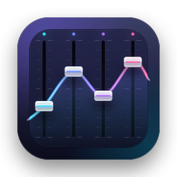

<p align="center">
  <b>한국어</b> · <a href="README.en.md">English</a> · <a href="README.zh-CN.md">简体中文</a> · <a href="README.ja.md">日本語</a>
</p>

<p align="center">
  
</p>

<h1 align="center">Audio Mixer</h1>

<p align="center">
  macOS 메뉴 막대 오디오 믹서 · 앱별 볼륨 · 이퀄라이저 · AutoEQ<br>
  <a href="https://github.com/jayusop/Audio-Mixer/releases/latest"><b>⬇ 최신 버전 다운로드</b></a> ·
  <a href="https://jayusop.github.io/Audio-Mixer/">소개 페이지</a>
</p>

<p align="center">
  
  
  
</p>

---

메뉴 막대에 상주하며 **앱별 볼륨**, **입·출력 장치 볼륨**, **그래픽/파라메트릭 이퀄라이저**, **AutoEQ 헤드폰 보정 프로필**을 제공하는 macOS 앱입니다. 가상 오디오 드라이버를 설치할 필요가 없습니다.

> 요구 사항: macOS 14.2 이상 (Apple Silicon / Intel)<br>
> 🌐 앱 언어는 macOS 시스템 언어(한국어, 영어, 중국어, 일본어)를 따르며, 그 외 언어에서는 영어로 표시됩니다.

## 설치

1. [Releases](https://github.com/jayusop/Audio-Mixer/releases/latest)에서 `AudioMixer.zip`을 내려받아 압축을 풀고, `AudioMixer.app`을 **응용 프로그램** 폴더로 옮깁니다.
2. 처음 실행하면 "확인되지 않은 개발자" 경고가 뜹니다(Apple 공증을 받지 않은 개인 배포 앱). **완료**를 누른 뒤 **시스템 설정 › 개인정보 보호 및 보안** 아래쪽의 **그래도 열기**를 클릭하세요. 터미널을 쓴다면:
   ```bash
   xattr -dr com.apple.quarantine /Applications/AudioMixer.app
   ```
3. 메뉴 막대에 페이더 아이콘이 나타나고, 처음 오디오를 처리할 때 **"시스템 오디오 녹음"** 권한을 요청합니다 → **허용**. (놓쳤다면 시스템 설정 › 개인정보 보호 및 보안 › 화면 및 시스템 오디오 녹음에서 켜세요.)

> 새 버전으로 업데이트한 뒤 권한을 다시 묻는다면, 권한 목록에서 기존 Audio Mixer 항목을 지우고 다시 허용하세요.

## 기능

| 영역 | 기능 |
|---|---|
| 믹서 | 출력/입력 장치 선택, 하드웨어 볼륨·음소거, 하드웨어 볼륨 없는 장치(HDMI 등)는 소프트웨어 볼륨 |
| 앱별 볼륨 | 재생 중인 앱 자동 감지, 0–100%(옵션 200%), 음소거, 레벨 미터, 앱별 설정 기억, 처리 제외 |
| 이퀄라이저 | 10밴드 그래픽 EQ(±12 dB), 최대 32개 파라메트릭 필터(PK/LSC/HSC/LP/HP/NO), 주파수 응답 곡선, 드래그 편집 |
| AutoEQ | AutoEQ 데이터베이스(약 8,800개 헤드폰/이어폰) 온라인 검색·적용, ParametricEQ.txt 가져오기/내보내기 |
| 프리셋 | 기본 17종 + 사용자 프리셋 저장/덮어쓰기/삭제, **출력 장치별 프리셋 자동 전환** |
| 음질 보호 | 자동 프리앰프(최대 부스트만큼 감쇄), 피크 리미터, 하드 클립 보호, L/R 밸런스 |
| 기타 | 로그인 시 자동 실행, 처리 전체 On/Off 스위치, 한국어 · 영어 · 중국어 · 일본어 UI |

## 안심하고 쓰세요

- **녹음하지 않습니다**: 오디오는 실시간으로 처리만 되며 저장하거나 외부로 보내지 않습니다.
- **앱을 꺼도 소리는 그대로**: Audio Mixer가 종료되거나 비정상 종료되면 모든 앱의 소리가 즉시 원래대로 돌아옵니다.
- **자동 복구**: 출력 장치 변경, 잠자기/깨우기 후에도 스스로 다시 연결됩니다.
- **간섭 없음**: 다른 오디오 장치로 직접 출력하는 앱(예: 오디오 인터페이스를 쓰는 DAW)은 건드리지 않습니다.

## 참고 / 제한

- 권한을 거부하면 앱별 볼륨·EQ는 동작하지 않으며(소리는 정상 재생), 장치 볼륨 제어만 가능합니다.
- 앱이 재생을 시작한 직후 아주 짧은 순간은 처리 전 소리가 날 수 있습니다.

## 크레딧 & 문의

- EQ 프로필 데이터: [AutoEq](https://github.com/jaakkopasanen/AutoEq) (jaakkopasanen)
- 버그 신고: [Issues](https://github.com/jayusop/Audio-Mixer/issues) · 메일 jayusop@gmail.com
